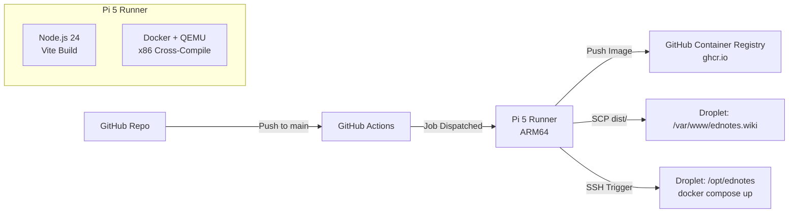

# Self-Hosted Runner Setup (Raspberry Pi 5)

This guide walks through configuring a dedicated Raspberry Pi 5 as a self-hosted GitHub Actions runner (`pi-web-builder`) for building and deploying the EdNotes web client and backend container to a DigitalOcean Droplet.

---

## Architecture Overview



---

## 1. Operating System & Initial Provisioning

1. Open **Raspberry Pi Imager**:
   - **Device**: Raspberry Pi 5.
   - **Operating System**: Raspberry Pi OS Lite (64-bit).
2. Click **Next / Edit Settings** to pre-configure:
   - **Hostname**: `pi-web-builder` (or your preferred local hostname).
   - **User & Password**: e.g., `edrip222`.
   - **Wireless LAN / Ethernet**: Configure Wi-Fi or LAN credentials.
   - **Services**: Enable SSH (using password or public key authentication).
3. Insert your microSD card and flash the OS.

---

## 2. System Preparation & Swap Space

1. Boot the Pi and connect over SSH:
   ```bash
   ssh edrip222@pi-web-builder.local
   ```

2. Perform an initial system update:
   ```bash
   sudo apt update && sudo apt full-upgrade -y
   sudo reboot
   ```

3. **Expand Swap Space**:
   Building Vite assets and cross-compiling x86 Docker images with QEMU are memory-intensive. Allocate a 2 GB swap file to prevent out-of-memory (OOM) failures:
   ```bash
   sudo swapoff -a
   sudo dd if=/dev/zero of=/swapfile bs=1M count=2048
   sudo chmod 600 /swapfile
   sudo mkswap /swapfile
   sudo swapon /swapfile
   ```

4. Verify swap allocation:
   ```bash
   free -h
   ```

5. Persist swap across reboots:
   ```bash
   echo '/swapfile swap swap defaults 0 0' | sudo tee -a /etc/fstab
   ```

---

## 3. Install Docker & Build Tools

1. Install Docker using the official automated script:
   ```bash
   curl -fsSL https://get.docker.com -o get-docker.sh
   sudo sh get-docker.sh
   ```

2. Add your user to the `docker` group so the runner can invoke Docker without `sudo`:
   ```bash
   sudo usermod -aG docker $USER
   ```

3. Activate group changes immediately (or log out and back in):
   ```bash
   newgrp docker
   ```

4. Verify Docker is operational:
   ```bash
   docker version
   ```

---

## 4. GitHub Environment & Security Configuration

Because this repository is public, self-hosted runners require strict security gating to avoid arbitrary code execution from pull requests.

### A. Environment Gate
1. On GitHub, navigate to **Settings > Environments**.
2. Click **New environment** and name it `production`.
3. Under **Deployment protection rules**, enable **Required reviewers**.
4. Add your GitHub username as the required reviewer and click **Save protection rules**.

### B. Action Permissions
1. Navigate to **Settings > Actions > General**.
2. Under **Fork pull request workflows from outside collaborators**, select:
   - **Require approval for all external contributors**.
3. Under **Workflow permissions**, select **Read and write permissions** (needed for pushing Docker images to GitHub Container Registry `ghcr.io`).

### C. Repository Secrets
Navigate to **Settings > Secrets and variables > Actions** and add the following repository secrets:

| Secret Name | Value |
|---|---|
| `DROPLET_IP` | Public IP address of your DigitalOcean Droplet. |
| `DROPLET_USER` | Deployment user on Droplet (e.g., `root` or a dedicated deployer). |
| `DROPLET_SSH_KEY` | Private SSH key matching an authorized key on your Droplet. |

---

## 5. Install & Register GitHub Actions Runner

1. On GitHub, navigate to **Settings > Actions > Runners**.
2. Click **New self-hosted runner**.
3. Select **Runner image**: `Linux`, **Architecture**: `ARM64`.
4. On your Raspberry Pi, create a directory for the runner and navigate into it:
   ```bash
   mkdir -p ~/actions-runner && cd ~/actions-runner
   ```
5. Download and extract the runner package (copy the latest version URL from the GitHub prompt):
   ```bash
   # Example version - replace with current version shown in GitHub UI:
   curl -o actions-runner-linux-arm64.tar.gz -L https://github.com/actions/runner/releases/download/v2.322.0/actions-runner-linux-arm64-2.322.0.tar.gz
   tar xzf ./actions-runner-linux-arm64.tar.gz
   ```
6. Configure the runner with your repository URL and one-time registration token:
   ```bash
   ./config.sh --url https://github.com/<YOUR_GITHUB_USERNAME>/ednotes --token <REGISTRATION_TOKEN>
   ```
   - Accept default runner name or customize (e.g., `pi-web-builder`).
   - Default labels: `self-hosted,Linux,ARM64`.

7. Install and launch the runner as a background systemd service:
   ```bash
   sudo ./svc.sh install
   sudo ./svc.sh start
   ```

8. Check service status:
   ```bash
   sudo ./svc.sh status
   ```

---

## 6. Deployment Target Paths & Reference Files

The deployment pipeline connects the following locations:

- **Repository**:
  - [`.github/workflows/deploy.yml`](file:///.github/workflows/deploy.yml): Main CI/CD pipeline running on `self-hosted`.
  - [`server/Dockerfile`](file:///server/Dockerfile): Backend container definition.
  - `apps/web-client`: Frontend Vite source.
- **Droplet (Production)**:
  - `/var/www/ednotes.wiki`: Frontend static asset destination (populated via SCP).
  - `/opt/ednotes`: Directory housing `docker-compose.yml` for backend orchestration.